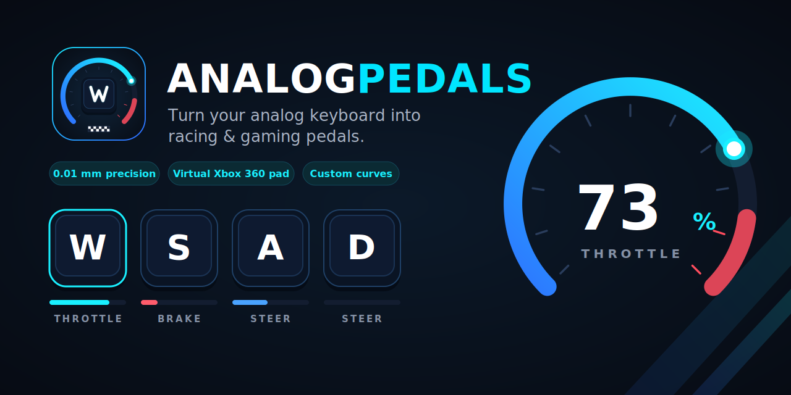

# AnalogPedals

<p align="center">
  
</p>


Turn the **Hall-effect analog keys** of an **AULA WIN68 HE** keyboard into a
virtual **Xbox 360 controller**. One key is your accelerator
(Right Trigger), another is your brake (Left Trigger), a pair steers the
left stick — and the gamepad feels how far the key is actually pressed:
0.01 mm resolution, ~340 samples of travel, at full keyboard scan rate.

Tested end-to-end on Windows 11 with ViGEmBus: full presses → RT/LT = 255,
half presses → ~120, release → 0.

## Features

- **Any key → any control**: two triggers, both sticks (four-axis pairs),
  face buttons, bumpers, Back/Start — bind by clicking **Bind** and pressing
  the physical key to full travel; it binds when the key returns to rest.
- **Real analog output**, not on/off: trigger value is proportional to
  travel; sticks interleave smoothly both axes per frame.
- **Response curves**: gamma per group (`out = fraction^gamma`) for pedals
  and each stick axis, live curve preview; dead zone, full travel and the
  button-actuation threshold as live sliders.
- **OS-level key blocking** of mapped keys (optional) with a passive
  **key-name auto-learner** (HID edge × keyboard hook cross-match).
- **Tkinter UI** with live telemetry (pedal cylinders, stick radars,
  curve plots), profile system with export/import, and a command-line
  mode for headless use.
- **Clean exit**: triggers zeroed and board streaming switched off —
  your keyboard returns to normal keyboard duties.

## Requirements

| | |
|---|---|
| OS | Windows 10/11 (X64) |
| Python | 3.11+ (3.12 tested) |
| Keyboard | AULA WIN 68 HE (`VID 2E3C` `PID C365`), wired USB |
| Driver | [ViGEmBus](https://github.com/nefarius/ViGEmBus/releases) — virtual Xbox 360 emulation |
| Python packages | `pip install -r requirements.txt` (`hidapi`, `vgamepad`) |

> **Adapt to other boards:** the vendor protocol was confirmed on the WIN 68 HE;
> it shares its family with other Aula HE boards (see
> [Aether-HE](https://github.com/MrWhosNexus/Aether-HE)'s board registry for
> VID/PID pairs of related models).

## Install

1. **ViGEmBus driver** — install from
   [nefarius/ViGEmBus releases](https://github.com/nefarius/ViGEmBus/releases)
   (the standard virtual-controller driver). Verify with
   `driverquery | findstr ViGEm`.
2. **Python deps** —

   ```
   python -m pip install -r requirements.txt
   ```

3. Plug the WIN 68 HE in via **USB cable** (2.4 GHz mode does not expose
   the vendor interface).

## Run

UI:

```
python pedals_ui.py
```

Headless CLI (a console that binds to the default profile):

```
python analogpedals.py
```

Handy dev utilities:

- `capture.py N` — log raw analog frames for N seconds (identify a key by index)
- `probe2.py` — quick connectivity probe
- `xinput_test.py` — watch the virtual pad's triggers/sticks in real time

## How it works

1. The WIN 68 HE exposes three USB HID interfaces. `MI_02`
   (`VID 2E3C PID C365`, usage page `0xFF1B`, usage `0x91`, Report ID `0x01`,
   63-byte payloads) is the vendor interface the official AULA web driver
   talks to — input + output only, **no feature reports**.
2. AnalogPedals opens that interface and sends the actuation/trigger_test
   command to stream **all** keys: body `21 00 00 00 18 02 <22-byte key mask→0xFF>`.
3. A frame streams whenever a covered key's travel changes:
   `body[0]=0x21 (cmd 33)`, `body[5]==1`, `row = body[6]`, `col = body[7]`,
   `index = row*22 + col`, `travel = body[8] | body[9] << 8` in
   **0.01 mm units** (full travel ≈ 3.4–3.7 on this unit). A heartbeat
   (`cmd 1`) keeps the link alive every 2 s.
4. Travel is linearly mapped to the XInput trigger bytes of a virtual
   Xbox 360 pad created through ViGEmBus (via `vgamepad`), with a
   configurable dead zone, full-travel point, and per-axis gamma curves.

`aula_protocol.py` is a **clean-room reimplementation** shipped as part of
AnalogPedals; the byte layout it commands was reverse-engineered together
with the hardware-verified knowledge published by the
[Aether-HE](https://github.com/MrWhosNexus/Aether-HE) drivers (attribution
below — no upstream source is included).

## Project layout

| File | Purpose |
|---|---|
| `analogpedals.py` | Core + CLI: HID reader thread, mapping engine, virtual pad, blocking, auto-learn, config/presets |
| `pedals_ui.py` | Tkinter GUI: bind-by-press, live gauges, curve sliders, profiles, export |
| `aula_protocol.py` | Minimal vendor-HID protocol builders (open-stream, heartbeat, closing frames) |
| `pedals.ini` | Binding table, dead zone, full travel, curve gammas (auto-created/updated) |
| `launch_ui.bat` | One-click launcher for the UI on Windows |

## License

MIT — see [LICENSE](LICENSE).

> **Disclaimer.** Not affiliated with or endorsed by AULA, Microsoft, ViGEm,
> or Nefarius. Use at your own risk; the protocol is undocumented and was
> reverse-engineered, so behaviour may change with keyboard/firmware updates.

## Acknowledgements

- **Aether-HE** — their hardware-verified protocol research for the Aula Win60/WIN 68
  HE board family was the roadmap for the vendor HID interface used here; byte
  layouts cited in this README were learned from that work and re-verified
  on a physical WIN 68 HE. No source code from Aether-HE is included.
- **ViGEmBus / Nefarius** — the virtual Xbox 360 controller driver this project
  rides on.
- **vgamepad** — the Python client library for ViGEm.
